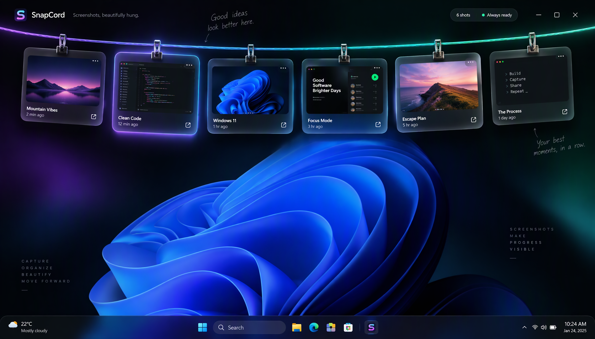

# 🪢 SnapCord · 图索

> 📸 截图暂存与桌面贴图工具

SnapCord 是 PicRope 的独立重写版本，使用 Tauri 2.0 (Rust) + Vue 3 构建，提供高端的视觉体验和流畅的交互。



## ✨ 功能

- 🖼️ **截图收集** — 自动收集 Windows 截图文件夹中的新图片，支持剪贴板图片与手动导入
- 📋 **复制与拖拽** — 单击复制图片，拖入聊天框、文档等目标应用；滚轮浏览更多挂图
- 📌 **桌面贴图** — 将图片固定置顶，拖动调整位置，滚轮缩放，点击图钉可重新挂回
- 🧺 **图片篮子** — 保存暂时不用的截图，支持多选、大图预览与批量挂图
- ✉️ **文字信封** — 收集剪贴板文字，支持搜索、查看全文与复制，保留原文换行和缩进
- 🎨 **本地编辑** — 直接标注、添加文字、裁剪和旋转，图片处理在本机完成
- ✂️ **区域截图** — 自定义快捷键框选，原地画框、画圆、加箭头、涂画、写文字或打局部马赛克
- 🖥️ **桌面适配** — 多套外观、多显示器选择、顶部自动收起，支持开机启动和应用内更新

## 🛠️ 技术栈

- **后端**: Rust + Tauri 2.0
- **前端**: Vue 3 + TypeScript + Vite
- **样式**: 自定义 CSS 变量系统（玻璃拟态、双边框卡片）
- **动效**: CSS transitions + cubic-bezier 缓动

## 🚀 开发

```bash
# 安装依赖
cd ui && npm install

# 启动开发服务器
npm run tauri dev

# 构建生产版本
npm run tauri build
```

## 📁 项目结构

```
SnapCord/
├── ui/                    # Vue 3 前端
│   ├── src/
│   │   ├── components/    # UI 组件
│   │   ├── composables/   # 组合式函数
│   │   ├── stores/        # Pinia 状态管理
│   │   └── views/         # 页面视图
│   └── package.json
│
├── server/                # Rust/Tauri 后端
│   ├── src/
│   │   ├── main.rs        # 入口
│   │   └── lib.rs         # 库根
│   ├── Cargo.toml
│   └── tauri.conf.json
│
├── LICENSE                # MIT 协议
├── NOTICE                 # 来源说明
└── README.md
```

## 🎨 设计系统

SnapCord 采用高端玻璃拟态设计语言：

- **配色**: OLED 黑底 + 紫/绿渐变强调色
- **卡片**: 双边框结构（外层磨砂 + 内层高光）
- **动效**: 弹簧物理缓动，GPU 加速 transform
- **排版**: Geist 字体族，清晰层级

详见 [ui/src/assets/design-system.md](ui/src/assets/design-system.md)

## 📄 许可

本项目基于 PicRope 独立重写，遵循 MIT 协议。

- 原项目: [PicRope](https://github.com/Renly1994/PicRope)
- 上游: [Tendedero](https://github.com/alejandrobujan/tendedero)

完整许可信息见 [LICENSE](LICENSE) 和 [NOTICE](NOTICE)。

## 🙏 致谢

- Tauri Framework
- Vue.js
- Vite
- PicRope / Tendedero 原作者
